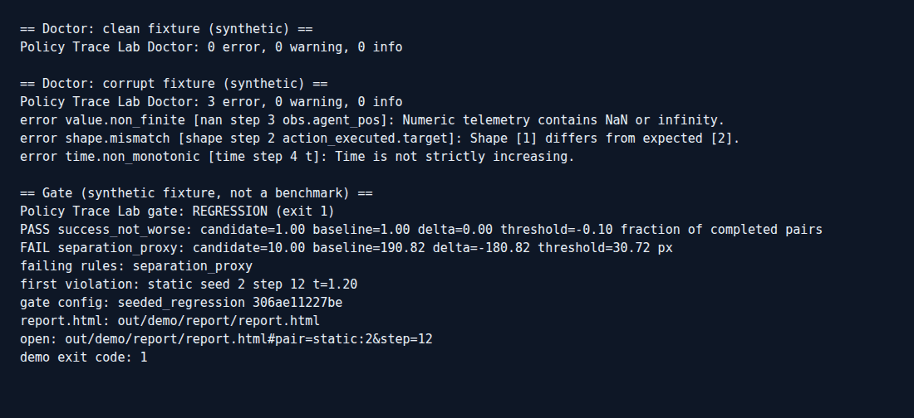
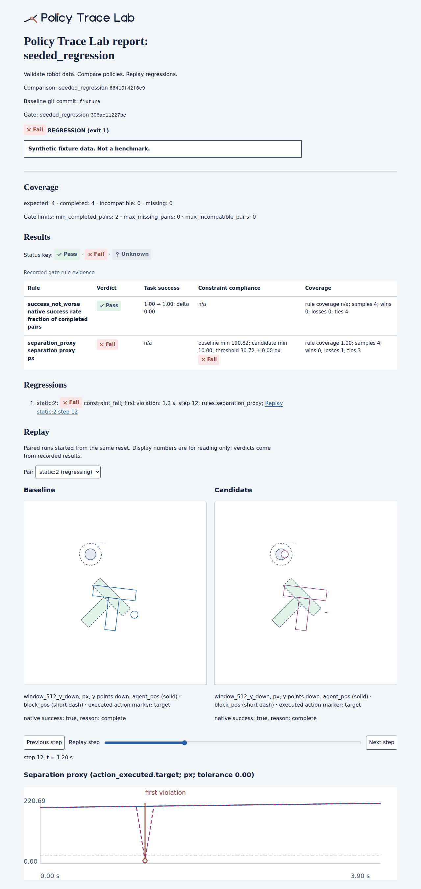
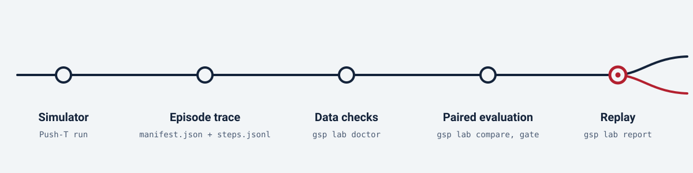
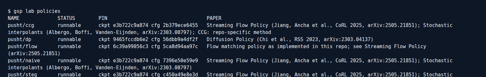
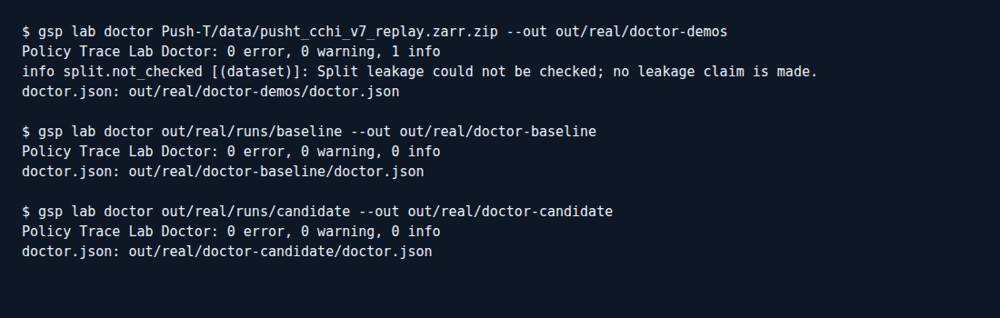
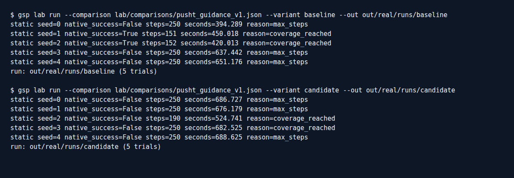
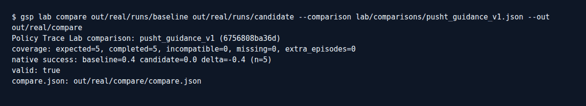
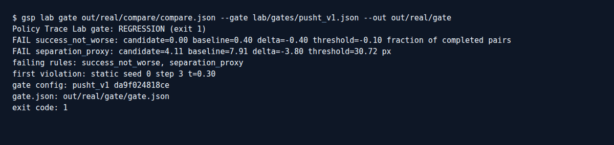
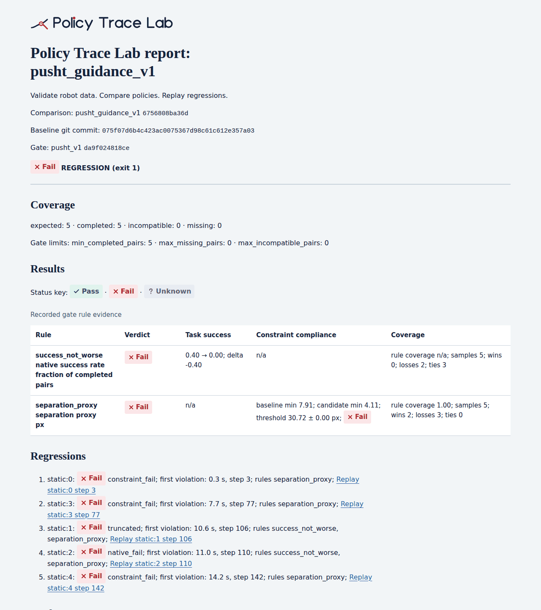
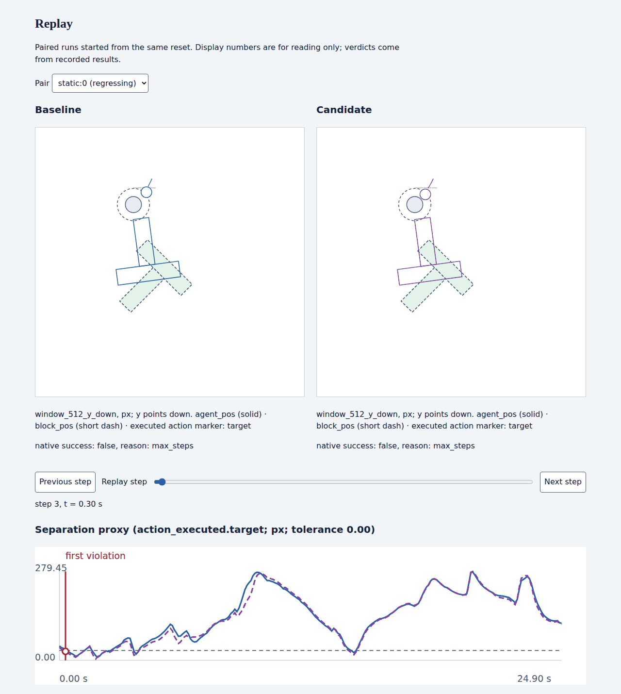

<p align="center">
  <picture>
    <source media="(prefers-color-scheme: dark)" srcset="docs/brand/readme-banner-dark.svg">
    
  </picture>
</p>

# Policy Trace Lab

**Validate robot data. Compare policies. Replay regressions.**

Policy Trace Lab is an open-source workbench that checks demonstration data, compares two robot policies under identical simulation conditions against a release rule you declare in advance, and opens the first regression at the timestep that caused it. It works on Push-T today and is built to take more tasks (Robomimic next) without changing its core.

[Quickstart](#quickstart) · [See it work](#see-it-work-a-real-push-t-run) · [Which command do I run?](#which-command-do-i-run) · [Command reference](#command-reference) · [Guided workflows](#guided-workflows) · [Reference policies](#play-with-the-reference-policies) · [Configuration](#configuration-reference) · [Exit codes](#exit-codes) · [Troubleshooting](#troubleshooting)

## Quickstart

You need Python 3.10 or newer and a clone of this repository. The demo needs only the CPU and the default install: no GPU, no network after the clone, no simulator and no checkpoint download.

```bash
git clone https://github.com/Praneeth-Suresh/robot-policy.git
cd robot-policy
python -m venv .venv && .venv/bin/pip install -e .
.venv/bin/gsp lab demo --out out/demo
```

The demo runs Doctor on a clean and a corrupt synthetic fixture, then compares, gates and reports on a synthetic fixture with a seeded regression. It exits with code 1 because the gate finds the regression. That is the expected result. This is the real terminal output:

```bash offline exit=1
gsp lab demo --out out/demo
```

```text
== Doctor: clean fixture (synthetic) ==
Policy Trace Lab Doctor: 0 error, 0 warning, 0 info

== Doctor: corrupt fixture (synthetic) ==
Policy Trace Lab Doctor: 3 error, 0 warning, 0 info
error value.non_finite [nan step 3 obs.agent_pos]: Numeric telemetry contains NaN or infinity.
error shape.mismatch [shape step 2 action_executed.target]: Shape [1] differs from expected [2].
error time.non_monotonic [time step 4 t]: Time is not strictly increasing.

== Gate (synthetic fixture, not a benchmark) ==
Policy Trace Lab gate: REGRESSION (exit 1)
PASS success_not_worse: candidate=1.00 baseline=1.00 delta=0.00 threshold=-0.10 fraction of completed pairs
FAIL separation_proxy: candidate=10.00 baseline=190.82 delta=-180.82 threshold=30.72 px
failing rules: separation_proxy
first violation: static seed 2 step 12 t=1.20
gate config: seeded_regression 306ae11227be
report.html: out/demo/report/report.html
open: out/demo/report/report.html#pair=static:2&step=12
demo exit code: 1
```



Open `out/demo/report/report.html` in a browser. The page opens at the first regression: baseline and candidate side by side at the step where the candidate crosses the separation threshold, with signal traces below.



*Synthetic fixture data. Not a benchmark. Generated from the bundled fixtures at the commit named in the page header.*

## How it fits together



Every capability reads or writes the same versioned **episode trace**, so data checks, comparisons and replay agree on what an episode is. [Architecture](docs/lab/architecture.md) has the module layout and dependency rules. [Schema](docs/lab/schema.md) documents the trace format.

### Glossary

| Term | Meaning |
| --- | --- |
| Episode | One run of a task from a start state to its end: a demonstration or a policy rollout. |
| Trace | An episode written in the lab's format: a `manifest.json` (facts about the episode) and a `steps.jsonl` (one line per timestep). |
| Run | A directory of rollout traces for one variant, plus `run_manifest.json`. |
| Matrix cell | One (task, condition, seed). The comparison config lists every cell explicitly. |
| Pair | The baseline episode and the candidate episode for one matrix cell. Its status is `completed`, `incompatible` or `missing`. |
| Gate | A checked-in rule set (thresholds, units, tolerances, required checks) applied to a comparison. |
| Unknown | A check that cannot be evaluated because the evidence is missing or too sparse. It is never guessed, and a required `unknown` blocks the gate (exit 2). |
| Separation proxy | Distance between where the policy told the agent to go and the obstacle centre. It is a proxy, not contact. |
| Reference policy | A method this repository implements, registered by name and pinned by checkpoint and configuration hash. |
| Synthetic | Fixture data made for tests and the demo. It is never a benchmark. |

## See it work: a real Push-T run

This is a real run on a CPU, not a fixture. It compares `pusht/dp` with its guidance on (`guidance_scale` 2.0) against the same policy with guidance off (`guidance_scale` 0.0), over seeds 0 to 4, with the checked-in files `lab/comparisons/pusht_guidance_v1.json` and `lab/gates/pusht_v1.json`. The choice was recorded in [decisions](docs/lab/decisions.md) before the run. The gate verdict is whatever the declared rule produced. It says nothing about which method is better in general. The full record, with versions, hashes and per-seed results, is in [real run](docs/lab/real-run.md).

**1. List the reference policies.** All five Push-T methods are registered, pinned and runnable on this machine.



*Run `pusht_guidance_v1`, seeds 0 to 4, commit `9727252`. Verified in simulation.*

```text
$ gsp lab policies
NAME             STATUS        PIN                                  PAPER
pusht/ccg        runnable      ckpt e3b722c9a874 cfg 2b379ece6455   Streaming Flow Policy (Jiang, Ancha et al., CoRL 2025, arXiv:2505.21851); Stochastic interpolants (Albergo, Boffi, Vanden-Eijnden, arXiv:2303.08797); CCG: repo-specific method
pusht/dp         runnable      ckpt 9465fccdb6e2 cfg 56dbb9a4df2f   Diffusion Policy (Chi et al., RSS 2023, arXiv:2303.04137)
pusht/flow       runnable      ckpt 6c39a99056c3 cfg 5ca8d94aa97c   Flow matching policy as implemented in this repo; see Streaming Flow Policy (arXiv:2505.21851)
pusht/naive      runnable      ckpt e3b722c9a874 cfg 7396e50e59e9   Streaming Flow Policy (Jiang, Ancha et al., CoRL 2025, arXiv:2505.21851); Stochastic interpolants (Albergo, Boffi, Vanden-Eijnden, arXiv:2303.08797)
pusht/steg       runnable      ckpt e3b722c9a874 cfg c450a49e8e3d   Streaming Flow Policy (Jiang, Ancha et al., CoRL 2025, arXiv:2505.21851); Stochastic interpolants (Albergo, Boffi, Vanden-Eijnden, arXiv:2303.08797); STEG: repo-specific method
```

**2. Check the data and the recordings with Doctor.** The native demonstration file has no split, so the only finding is the info `split.not_checked`. Both recorded runs come back clean.



*Run `pusht_guidance_v1`, seeds 0 to 4, commit `9727252`. Verified in simulation.*

```text
$ gsp lab doctor Push-T/data/pusht_cchi_v7_replay.zarr.zip --out out/real/doctor-demos
Policy Trace Lab Doctor: 0 error, 0 warning, 1 info
info split.not_checked [(dataset)]: Split leakage could not be checked; no leakage claim is made.
doctor.json: out/real/doctor-demos/doctor.json

$ gsp lab doctor out/real/runs/baseline --out out/real/doctor-baseline
Policy Trace Lab Doctor: 0 error, 0 warning, 0 info
doctor.json: out/real/doctor-baseline/doctor.json

$ gsp lab doctor out/real/runs/candidate --out out/real/doctor-candidate
Policy Trace Lab Doctor: 0 error, 0 warning, 0 info
doctor.json: out/real/doctor-candidate/doctor.json
```

**3. Run both variants.** One log line per trial. The `pusht/dp` trials took 394 s to 687 s each on this CPU.



*Run `pusht_guidance_v1`, trials recorded at commit `075f07d`. Verified in simulation.*

```text
$ gsp lab run --comparison lab/comparisons/pusht_guidance_v1.json --variant baseline --out out/real/runs/baseline
static seed=0 native_success=False steps=250 seconds=394.289 reason=max_steps
static seed=1 native_success=True steps=151 seconds=450.018 reason=coverage_reached
static seed=2 native_success=True steps=152 seconds=420.013 reason=coverage_reached
static seed=3 native_success=False steps=250 seconds=637.442 reason=max_steps
static seed=4 native_success=False steps=250 seconds=651.176 reason=max_steps
run: out/real/runs/baseline (5 trials)

$ gsp lab run --comparison lab/comparisons/pusht_guidance_v1.json --variant candidate --out out/real/runs/candidate
static seed=0 native_success=False steps=250 seconds=686.727 reason=max_steps
static seed=1 native_success=False steps=250 seconds=676.179 reason=max_steps
static seed=2 native_success=False steps=190 seconds=524.741 reason=coverage_reached
static seed=3 native_success=False steps=250 seconds=682.525 reason=coverage_reached
static seed=4 native_success=False steps=250 seconds=688.625 reason=max_steps
run: out/real/runs/candidate (5 trials)
```

**4. Compare.** All five pairs are `completed`: same reset state, only the declared difference. The native success rate falls from 0.4 to 0.0.



*Run `pusht_guidance_v1`, seeds 0 to 4, commit `9727252`. Verified in simulation.*

```text
$ gsp lab compare out/real/runs/baseline out/real/runs/candidate --comparison lab/comparisons/pusht_guidance_v1.json --out out/real/compare
Policy Trace Lab comparison: pusht_guidance_v1 (6756808ba36d)
coverage: expected=5, completed=5, incompatible=0, missing=0, extra_episodes=0
native success: baseline=0.4 candidate=0.0 delta=-0.4 (n=5)
valid: true
compare.json: out/real/compare/compare.json
```

**5. Gate.** The declared rule fails on both required checks, so the verdict is `REGRESSION` with exit code 1. The first violation is seed 0 at step 3.



*Run `pusht_guidance_v1`, seeds 0 to 4, commit `9727252`. Verified in simulation.*

```text
$ gsp lab gate out/real/compare/compare.json --gate lab/gates/pusht_v1.json --out out/real/gate
Policy Trace Lab gate: REGRESSION (exit 1)
FAIL success_not_worse: candidate=0.00 baseline=0.40 delta=-0.40 threshold=-0.10 fraction of completed pairs
FAIL separation_proxy: candidate=4.11 baseline=7.91 delta=-3.80 threshold=30.72 px
failing rules: success_not_worse, separation_proxy
first violation: static seed 0 step 3 t=0.30
gate config: pusht_v1 da9f024818ce
gate.json: out/real/gate/gate.json
exit code: 1
```

**6. Open the report.** The overview shows the verdict with its exit code, the coverage panel (5 expected, 5 completed), the results table with task success and constraint compliance in separate columns, and the regression list. Each regression links to its first discrepancy.



*Run `pusht_guidance_v1`, seeds 0 to 4, commit `9727252`. Verified in simulation.*

**7. Replay the first regression.** The link for seed 0 opens the replay at step 3: baseline and candidate side by side from the same reset, with the separation proxy below and a marker where the candidate first crosses the threshold.



*Run `pusht_guidance_v1`, seeds 0 to 4, commit `9727252`. Verified in simulation.*

**What the real run exposed.** The runner's own minimum distance for `pusht/dp` and `pusht/flow` is measured on the agent position, not on the action target that the committed gate used. The lab compared both against the runner's number on every episode and found the difference. A supplementary gate on `obs.agent_pos` gives the same verdict. Details are in [real run](docs/lab/real-run.md).

## Which command do I run?

| I want to… | Run |
| --- | --- |
| See the whole workflow in five minutes, offline | `gsp lab demo --out out/demo` |
| List the reference policies and their pins | `gsp lab policies` |
| Check my demonstration data before training or evaluating | `gsp lab doctor <demonstration file or trace directory>` |
| Run my baseline and my variant in the Push-T simulator | `gsp lab run --comparison <config> --variant baseline`, then `--variant candidate` |
| Check the rollouts I just recorded | `gsp lab doctor <run directory>` |
| Check that the two runs are a fair pair, and see coverage | `gsp lab compare <baseline run> <candidate run> --comparison <config>` |
| Get a pass or fail against my declared rule, for a script or CI | `gsp lab gate <compare.json> --gate <config>` |
| Find out where a regression started | `gsp lab report <compare.json> --gate <gate.json>` |
| Use the research scripts without the lab | `gsp run <task>` or `Push-T/run_trial.py` (see [Research workspace](#research-workspace)) |

## Command reference

All commands are subcommands of `gsp lab`. They never overwrite earlier outputs: an existing output file with different content is an error (exit 2). Commands that need the simulator say so and list the assets. Unless noted, run the examples from the repository root of a fresh clone with no edits. Examples marked *offline* are executed by a test, and their exit codes are checked.

### `gsp lab policies`

- **What it does:** lists every registered reference policy with its status, paper and pin.
- **When to use it:** first, to see which policies can run on this machine. Before `gsp lab run`.
- **Usage:** `gsp lab policies [--task TASK]`

| Option | Required | Default | Meaning |
| --- | --- | --- | --- |
| `--task` | optional | `pusht` | Task adapter name |

- **Example:**

```bash offline exit=0
gsp lab policies
```

- **Example output** (trimmed to the first columns; the paper column is long):

```text
NAME             STATUS        PIN
pusht/ccg        runnable      ckpt e3b722c9a874 cfg 2b379ece6455
pusht/dp         runnable      ckpt 9465fccdb6e2 cfg 56dbb9a4df2f
pusht/flow       runnable      ckpt 6c39a99056c3 cfg 5ca8d94aa97c
pusht/naive      runnable      ckpt e3b722c9a874 cfg 7396e50e59e9
pusht/steg       runnable      ckpt e3b722c9a874 cfg c450a49e8e3d
```

- **Exit codes:** 0 listed; 3 usage error.
- **Next step:** write a comparison config naming a baseline and a candidate, then `gsp lab run`.

### `gsp lab doctor`

- **What it does:** validates demonstration data or recorded rollouts and writes `doctor.json`.
- **When to use it:** before training or evaluating on demonstration data, and again on each run directory after `gsp lab run`.
- **Usage:** `gsp lab doctor [--task TASK] [--out OUT] input`

| Argument or option | Required | Default | Meaning |
| --- | --- | --- | --- |
| `input` | required | none | An episode trace directory, a run directory of traces, or the task's native demonstration file (Push-T: the Zarr zip) |
| `--task` | optional | `pusht` | Task adapter, used to read native demonstration data |
| `--out` | optional | `out/doctor` | Directory for `doctor.json` |

Checks: `schema.missing_required`, `shape.mismatch`, `value.non_finite`, `time.non_monotonic`, `time.gap`, `split.leakage`, `split.duplicate_episode`, `split.not_checked`, `outcome.inconsistent`. Each finding names the episode and the step or field, and carries a hint. Reading the native Push-T file needs the `pusht` extra (`zarr`, `numpy`).

- **Example:**

```bash offline exit=1
gsp lab doctor tests/fixtures/lab/pusht/demos/corrupt --out out/doctor-corrupt
```

- **Example output:**

```text
Policy Trace Lab Doctor: 3 error, 0 warning, 0 info
error value.non_finite [nan step 3 obs.agent_pos]: Numeric telemetry contains NaN or infinity.
error shape.mismatch [shape step 2 action_executed.target]: Shape [1] differs from expected [2].
error time.non_monotonic [time step 4 t]: Time is not strictly increasing.
doctor.json: out/doctor-corrupt/doctor.json
```

- **Exit codes:** 0 no errors (warnings and info are allowed); 1 errors found; 2 input unreadable or the output would overwrite a different file; 3 usage or internal error.
- **Next step:** fix or accept the findings, then `gsp lab run`. For rollouts, `gsp lab compare`.

### `gsp lab run`

- **What it does:** runs one variant of a comparison in the simulator for every listed condition and seed, and records one episode trace per trial, including failures, truncations and crashes.
- **When to use it:** after you commit the comparison config and before you look at any result. Run `--variant baseline` and `--variant candidate`.
- **Usage:** `gsp lab run --comparison COMPARISON --variant {baseline,candidate} [--out OUT]`
- **Needs the simulator.** Push-T assets: the `pusht` extra (see [Setup and assets](#setup-and-assets)), `Push-T/data/pusht_cchi_v7_replay.zarr.zip`, and the checkpoints of the selected policy (`Push-T/checkpoints/`). Not runnable offline. The default Push-T run path is unchanged: the lab wraps the unmodified runners.

| Option | Required | Default | Meaning |
| --- | --- | --- | --- |
| `--comparison` | required | none | Comparison config (JSON) |
| `--variant` | required | none | `baseline` or `candidate` |
| `--out` | optional | `out/runs/<comparison name>/<variant>` | Run directory; must be empty or absent |

- **Example** (needs the assets above; about 20 s per `pusht/naive` trial on a CPU):

```bash
gsp lab run --comparison lab/comparisons/pusht_guidance_v1.json --variant baseline
```

- **Example output:** see the [real run](#see-it-work-a-real-push-t-run) for the recorded output of this command.
- **Exit codes:** 0 all trials recorded (crashed trials are recorded and logged); 2 setup invalid (unknown policy, unavailable policy, changed pin, wrong simulator version, non-empty output directory); 3 usage or internal error.
- **Next step:** `gsp lab doctor <run directory>`, then `gsp lab compare`.

### `gsp lab compare`

- **What it does:** matches baseline and candidate episodes by (task, condition, seed), checks that the pair is fair, and writes `compare.json` with pair statuses, deltas and coverage.
- **When to use it:** after both runs exist. Before `gsp lab gate`.
- **Usage:** `gsp lab compare --comparison COMPARISON [--out OUT] baseline_run candidate_run`

| Argument or option | Required | Default | Meaning |
| --- | --- | --- | --- |
| `baseline_run`, `candidate_run` | required | none | Run directories written by `gsp lab run` |
| `--comparison` | required | none | The same comparison config used for the runs |
| `--out` | optional | `out/compare/<comparison name>` | Directory for `compare.json` |

Pair statuses: `completed` (both episodes exist, reset fingerprints match, only intended configuration differences), `incompatible` (different or missing reset fingerprints, different simulator version, duplicate episodes), `missing` (an episode is absent). A failed, truncated or crashed trial is still `completed`: failure is data. The comparison itself is invalid (exit 2) when the runs came from another comparison file or their configurations differ in anything not listed in `intended_differences`.

- **Example:**

```bash offline exit=0
gsp lab compare tests/fixtures/lab/pusht/scenarios/seeded_regression/baseline tests/fixtures/lab/pusht/scenarios/seeded_regression/candidate --comparison tests/fixtures/lab/pusht/scenarios/seeded_regression/comparison.json --out out/compare-demo
```

- **Example output:**

```text
Policy Trace Lab comparison: seeded_regression (66410f42f6c9)
coverage: expected=4, completed=4, incompatible=0, missing=0, extra_episodes=0
native success: baseline=1.0 candidate=1.0 delta=0.0 (n=4)
valid: true
compare.json: out/compare-demo/compare.json
```

- **Exit codes:** 0 comparable; 2 invalid comparison or unreadable input; 3 usage or internal error.
- **Next step:** `gsp lab gate out/compare-demo/compare.json --gate <gate config>`.

### `gsp lab gate`

- **What it does:** applies your checked-in gate config to `compare.json` and writes `gate.json` and a text verdict.
- **When to use it:** after `gsp lab compare`. The gate config is committed before candidate results are inspected; the verdict states the config hash it used.
- **Usage:** `gsp lab gate --gate GATE [--out OUT] compare_json`

| Argument or option | Required | Default | Meaning |
| --- | --- | --- | --- |
| `compare_json` | required | none | `compare.json` from `gsp lab compare` |
| `--gate` | required | none | Gate config (JSON) |
| `--out` | optional | `out/gate/<gate name>` | Directory for `gate.json` |

The gate re-checks the trace file hashes recorded in `compare.json` and refuses traces that changed since the comparison.

- **Example:**

```bash offline exit=1
gsp lab gate out/compare-demo/compare.json --gate tests/fixtures/lab/pusht/scenarios/seeded_regression/gate.json --out out/gate-demo
```

- **Example output:**

```text
Policy Trace Lab gate: REGRESSION (exit 1)
PASS success_not_worse: candidate=1.00 baseline=1.00 delta=0.00 threshold=-0.10 fraction of completed pairs
FAIL separation_proxy: candidate=10.00 baseline=190.82 delta=-180.82 threshold=30.72 px
failing rules: separation_proxy
first violation: static seed 2 step 12 t=1.20
gate config: seeded_regression 306ae11227be
gate.json: out/gate-demo/gate.json
```

- **Exit codes:** 0 pass; 1 regression (a required rule failed); 2 invalid, incomplete, or a required check is `unknown`; 3 usage or internal error.
- **Next step:** `gsp lab report out/compare-demo/compare.json --gate out/gate-demo/gate.json`.

### `gsp lab report`

- **What it does:** writes one self-contained `report.html` (works offline, no network) with the verdict, coverage, a results table, the regression list and the replay view.
- **When to use it:** after `gsp lab gate`, to find where a regression started.
- **Usage:** `gsp lab report [--gate GATE] [--out OUT] compare_json`

| Argument or option | Required | Default | Meaning |
| --- | --- | --- | --- |
| `compare_json` | required | none | `compare.json` |
| `--gate` | optional | none | `gate.json` from `gsp lab gate`; without it the report has no verdict or regression list |
| `--out` | optional | `out/report/<comparison name>` | Directory for `report.html` |

- **Example:**

```bash offline exit=0
gsp lab report out/compare-demo/compare.json --gate out/gate-demo/gate.json --out out/report-demo
```

- **Example output:**

```text
report.html: out/report-demo/report.html
```

- **Exit codes:** 0 written; 2 unreadable input or the output would overwrite a different file; 3 usage or internal error.
- **Next step:** open the file. Each regression links to `report.html#pair=<condition>:<seed>&step=<n>`.

### `gsp lab demo`

- **What it does:** runs Doctor on a clean and a corrupt synthetic fixture, then compare, gate and report on a seeded-regression fixture.
- **When to use it:** first, to see the workflow; and in CI, to check the install.
- **Usage:** `gsp lab demo --out OUT [--task TASK]`

| Option | Required | Default | Meaning |
| --- | --- | --- | --- |
| `--out` | required | none | Output directory (identical existing files are kept; different ones are never overwritten) |
| `--task` | optional | `pusht` | Task adapter whose bundled fixtures are used |

- **Example:** the [Quickstart](#quickstart) command.
- **Exit codes:** same as the gate: 0 pass; 1 regression (the bundled fixture exits 1); 2 invalid or incomplete; 3 usage or internal error.
- **Next step:** open `out/demo/report/report.html`.

## Guided workflows

### Journey A: first-time visitor, five minutes, offline

1. Install: `python -m venv .venv && .venv/bin/pip install -e .` *(expected: no error; no heavy packages are installed)*.
2. Run `gsp lab demo --out out/demo` *(expected: three blocks of output and exit code 1)*.
3. Read the blocks. The corrupt fixture fails Doctor with named findings. The gate prints `REGRESSION (exit 1)` and the failing rule `separation_proxy`.
4. Open `out/demo/report/report.html` *(expected: verdict, coverage table, regression list with one row)*.
5. Click the first regression *(expected: replay scrubbed to the first violation step, with the signal plot marker)*.

### Journey B: researcher comparing two Push-T variants

1. **Validate data.** `gsp lab doctor Push-T/data/pusht_cchi_v7_replay.zarr.zip --out out/doctor-data`. *Expected: exit 0 and one info finding, `split.not_checked`, because the file has no split.* Fix or accept the findings before going further.
2. **Declare the comparison before running the candidate.** Copy `lab/comparisons/pusht_guidance_v1.json` and `lab/gates/pusht_v1.json`, edit them, and commit both. *Expected: `git log` shows the commit before any run directory exists.*
3. **Run both variants.** `gsp lab run --comparison <config> --variant baseline`, then `--variant candidate`. *Expected: one log line per trial and exit 0.*
4. **Validate the rollouts.** `gsp lab doctor out/runs/<name>/baseline` and the same for the candidate. *Expected: exit 0.*
5. **Compare.** `gsp lab compare out/runs/<name>/baseline out/runs/<name>/candidate --comparison <config>`. *Expected: exit 0 and `coverage: expected=N, completed=N`.* Unexpected configuration differences make the comparison invalid (exit 2).
6. **Gate.** `gsp lab gate out/compare/<name>/compare.json --gate <gate config>`. *Expected: exit 0 pass, 1 regression, or 2 blocked.*
7. **Explain.** `gsp lab report out/compare/<name>/compare.json --gate out/gate/<gate name>/gate.json`. *Expected: `report.html`; each regression links to its first discrepancy.*

### Journey C: CI or a reviewer

1. Run the offline tests: `python -m unittest discover -s tests`. *Expected: OK. Tests that need the simulator or its assets are skipped, not failed.*
2. Run `gsp lab demo --out out/demo` and assert exit code 1. *Expected: `out/demo/gate/gate.json` has `"verdict": "REGRESSION"` and the rule `separation_proxy` failing.*
3. Run your own held-out fixtures with the same commands. Every command accepts any input path.

The repository's workflow `.github/workflows/lab.yml` does steps 1 and 2.

## Play with the reference policies

Every Push-T method in this repository is registered as a reference policy: a thin adapter around the unchanged runner, with its checkpoint hash and resolved configuration hash pinned in `lab/pins.json`. No policy is the default. Any of them can be the baseline or the candidate. A test fails if a pin changes; changing a pin is a deliberate, reviewed edit. List them with `gsp lab policies`.

| Policy | What it is | Tunable settings (default) | Paper |
| --- | --- | --- | --- |
| `pusht/naive` | Streaming stochastic-interpolant policy with a hand-written repulsive force around the obstacle | `max_guidance_scale` (6.0) | Jiang, Ancha et al., *Streaming Flow Policy*, CoRL 2025, [arXiv:2505.21851](https://arxiv.org/abs/2505.21851); Albergo, Boffi, Vanden-Eijnden, [arXiv:2303.08797](https://arxiv.org/abs/2303.08797) |
| `pusht/ccg` | The same policy steered by a learned collision critic | `max_guidance_scale` (4.0) | as `pusht/naive`; CCG is a method of this repository |
| `pusht/steg` | Streaming SDE with ensemble guidance | `guidance_scale` (1.5), `N_ensemble` (64) | as `pusht/naive`; STEG is a method of this repository |
| `pusht/dp` | DDPM diffusion policy with inference-time gradient guidance | `guidance_scale` (2.0), `guidance_sign` (1.0), `grad_clip_norm` (1.0) | Chi et al., *Diffusion Policy*, RSS 2023, [arXiv:2303.04137](https://arxiv.org/abs/2303.04137) |
| `pusht/flow` | Flow-matching policy with inference-time gradient guidance | `guidance_scale` (5.0) | Flow matching policy as implemented in this repository; see [arXiv:2505.21851](https://arxiv.org/abs/2505.21851) |

Defaults are the values `Push-T/run_trial.py` passes for the static condition, or the runner's own defaults. The repository documents no supported range for these settings. Its dynamic-condition runs use `naive` 7.0, `ccg` 4.0, `steg` 7.0, `dp` 15.0 and `flow` 0.7, which are repository defaults for another condition, not recommended ranges. A policy whose checkpoint or package is missing is listed as `unavailable` with the exact reason, never dropped.

**Override a setting.** Add an `overrides` block to a variant and list the difference in `intended_differences`. No code edit is needed:

```json
{
  "variants": {
    "baseline": {"policy": "pusht/dp"},
    "candidate": {"policy": "pusht/dp", "overrides": {"guidance_scale": 0.0}}
  },
  "intended_differences": ["overrides.guidance_scale"]
}
```

**Compare two methods.** Name a different registered policy and list `policy` as the intended difference:

```json
{
  "variants": {
    "baseline": {"policy": "pusht/naive"},
    "candidate": {"policy": "pusht/ccg"}
  },
  "intended_differences": ["policy"]
}
```

**Use your own policy.** Give a Python import path `package.module:callable` instead of a registered name. The callable takes the task's `TrialRequest` and returns a `TrialRecord` (see `guided_streaming_policy/lab/tasks/base.py`). Its overrides are passed through unvalidated, and its manifests record `unregistered` for the checkpoint.

**Worked example.** The checked-in comparison `lab/comparisons/pusht_guidance_v1.json` compares `pusht/dp` with its guidance on and off over seeds 0 to 4, and `lab/gates/pusht_v1.json` is its gate. The [real run](#see-it-work-a-real-push-t-run) above used exactly these files:

```bash
gsp lab run --comparison lab/comparisons/pusht_guidance_v1.json --variant baseline
gsp lab run --comparison lab/comparisons/pusht_guidance_v1.json --variant candidate
```

The report states what the declared rule found for those runs. It makes no claim about which method is better in general.

## Configuration reference

Both configs are JSON files (the standard library has no YAML parser and the default install adds no dependency). Unknown keys are errors. Schemas: [comparison](schemas/comparison_config.schema.json), [gate](schemas/gate_config.schema.json).

### Comparison config

```jsonc
// Illustration only: real files are plain JSON and cannot contain comments.
{
  "schema_version": "0.1",              // always "0.1"
  "name": "pusht_guidance_v1",          // used in output paths and the report
  "task": "pusht",                      // registered task name
  "simulator_version": "7.2.0",         // must equal the installed simulator (pymunk for Push-T)
  "matrix": {
    "conditions": ["static"],           // unique names; Push-T supports "static"
    "seeds": [0, 1, 2, 3, 4]            // explicit list of unique non-negative integers
  },
  "variants": {                         // exactly these two keys
    "baseline":  {"policy": "pusht/dp"},
    "candidate": {"policy": "pusht/dp", "overrides": {"guidance_scale": 0.0}}
  },
  "intended_differences": ["overrides.guidance_scale"]  // "policy" or "overrides.<key>"
}
```

| Field | Type | Meaning |
| --- | --- | --- |
| `schema_version` | string | `"0.1"` |
| `name` | string | Comparison name |
| `task` | string | Registered task |
| `simulator_version` | string | Required simulator version; a mismatch is a setup error |
| `matrix.conditions` | list of strings | Conditions to run |
| `matrix.seeds` | list of integers | Seeds to run. Never computed at run time |
| `variants.baseline`, `variants.candidate` | object | `policy` (registered name or `package.module:callable`) and optional `overrides` (scalars only) |
| `intended_differences` | list of strings | The only differences allowed between the two resolved configurations: `policy`, or `overrides.<key>` where `<key>` appears in a variant's overrides. Any other difference makes the comparison invalid |

### Gate config

```jsonc
// Illustration only: real files are plain JSON and cannot contain comments.
{
  "schema_version": "0.1",
  "name": "pusht_v1",
  "min_completed_pairs": 5,        // fewer completed pairs: exit 2
  "max_missing_pairs": 0,          // more missing pairs: exit 2
  "max_incompatible_pairs": 0,     // more incompatible pairs: exit 2
  "rules": [
    {"id": "success_not_worse", "metric": "native_success_rate",
     "compare": "candidate_minus_baseline", "units": "fraction of completed pairs",
     "threshold": -0.1,            // passes when candidate rate - baseline rate >= -0.1
     "required": true},
    {"id": "separation_proxy", "metric": "obstacle_separation_min",
     "signal": "action_executed.target",   // step field holding the position
     "units": "px", "threshold": 30.72,    // minimum allowed distance (simulator units)
     "tolerance": 0.0,                     // a step violates when distance < threshold - tolerance
     "min_coverage": 0.95,                 // share of steps that must be measurable, else unknown
     "required": true}
  ]
}
```

| Field | Meaning |
| --- | --- |
| `min_completed_pairs`, `max_missing_pairs`, `max_incompatible_pairs` | Coverage limits; exceeding them gives exit 2 |
| `rules[].id` | Unique rule name used in `gate.json` and the report |
| `rules[].metric` | `native_success_rate` or `obstacle_separation_min` |
| `rules[].required` | Required rules decide the exit code. Non-required rules are reported only |
| `native_success_rate`: `compare`, `threshold`, `units` | `compare` is `candidate_minus_baseline`. The rule passes when the delta is at least `threshold`, so a negative threshold tolerates a drop of at most that size. Native success is copied from the simulator's runner and never recomputed |
| `obstacle_separation_min`: `signal`, `units`, `threshold`, `tolerance`, `min_coverage` | Judged on every completed pair's candidate episode. `units` must equal the obstacle geometry's units in the manifests. The result per episode is `pass`, `fail` or `unknown`; a rule fails when any episode fails, else is unknown when any is unknown |

Verdict order: invalid input or coverage beyond the limits gives exit 2; a required rule that is `unknown` gives exit 2; a required rule that fails gives exit 1; otherwise exit 0.

## Exit codes

| Code | Meaning | What to do next |
| --- | --- | --- |
| 0 | `policies`: listed. `doctor`: no errors. `run`: all trials recorded. `compare`: comparable. `gate`: pass. `report`: written. `demo`: pass | Go to the next command. |
| 1 | `doctor`: errors found. `gate` and `demo`: regression | `doctor`: read the findings and their hints. `gate`: run `gsp lab report` and open the first regression. The demo exits 1 by design. |
| 2 | Input invalid, unreadable or incomplete; setup invalid (`run`); output would overwrite a different file; `gate`: a required check is `unknown` | Read the message on stderr. See [Troubleshooting](#troubleshooting). For a blocked gate, the verdict lists the reasons (missing pairs, incompatible pairs, missing signal). |
| 3 | Usage error or internal error | Run the command with `--help`. Report internal errors with the full message. |

## Troubleshooting

| Message (shortened) | Cause | Fix |
| --- | --- | --- |
| `Input does not exist: <path>` (doctor) | The input path is wrong | Check the path. For native Push-T data it is `Push-T/data/pusht_cchi_v7_replay.zarr.zip`. |
| `Cannot read demonstrations ...: No module named 'zarr'` | Reading the native Push-T file needs `zarr` and `numpy` | Install the `pusht` extra (see [Setup and assets](#setup-and-assets)). |
| `refusing to overwrite <file>` | An output file exists with different content | Choose a new `--out` directory, or delete your own earlier output. |
| `Output directory must be empty; refusing to overwrite <dir>` (run) | The run directory already has files | Use a new `--out`. Earlier runs are never overwritten. |
| `Policy pusht/dp: unavailable: missing checkpoint ...` | A checkpoint is not in `Push-T/checkpoints/` | Fetch it as described in [Setup and assets](#setup-and-assets). `gsp lab policies` shows the status of every policy. |
| `Policy pusht/dp: unavailable: missing Python package ...` | The simulator environment is not installed | Install the `pusht` extra. |
| `pin changed: pusht/dp` | A checkpoint file or the resolved configuration differs from `lab/pins.json` | Restore the original checkpoint. If the change is deliberate, edit the pin in a reviewed commit. |
| `simulator version mismatch: expected '7.2.0', ...` | The comparison config names another pymunk version than the installed one | Install the pinned version, or change `simulator_version` and record why. |
| `Policy pusht/dp: Unknown tunable 'x'; valid keys: ...` | An override names a setting the policy does not declare | Use one of the listed keys. |
| `intended_differences[0]: expected policy or overrides.<existing key>` | The entry is misspelled or not in any variant's overrides | Fix the entry or add the override. |
| `valid: false` with `unintended configuration difference: settings.<key>` (compare) | The two runs differ in something you did not declare | Add it to `intended_differences` if intended, otherwise rerun both variants from the same config. |
| `incompatible [static seed=1]: reset state fingerprints differ` (compare) | The two episodes did not start from the same state | Rerun the pair with the same seed and simulator version. Incompatible pairs do not count toward metrics. |
| `missing [static seed=2]: missing episode in candidate run` (compare) | A trial was not recorded | Rerun the missing variant into a new directory. |
| `incompatible pairs 2 exceed maximum 0`, `missing pairs 2 exceed maximum 0`, `completed pairs 3 below minimum 5` (gate) | Coverage is below what the gate config requires | Fix the runs. Raise the limits only in a reviewed gate-config change. |
| `insufficient evidence: separation_proxy: signal action_executed.target was not collected` (gate) | The traces lack the signal the rule needs | Record the signal, or change the rule in a reviewed config. The gate never guesses. |
| `fixtures not found; run from a source checkout of the repository` (demo) | The demo reads `tests/fixtures/lab/`, which is not in a pip-installed wheel | Run it from a clone of the repository. |
| `gsp lab <command>: error: the following arguments are required: ...` (exit 3) | Missing argument | See the usage line above the message. |
| The report shows no replay | JavaScript is disabled | Enable it. The verdict, coverage, results and regression list are readable without it. |

## Supported tasks

| Task | In the lab | Notes |
| --- | --- | --- |
| Push-T | Supported: demonstration reader, run hook, five reference policies, fixtures | One condition (`static`). The `dynamic` condition runs through the research scripts only. |
| Robomimic (`can`, `square`, `lift`) | Not yet | Available through the existing research commands (`gsp run mimic-*`). It comes to the lab through [adding a task](docs/lab/adding-a-task.md). |

## Documentation

| Page | Contents |
| --- | --- |
| [Architecture](docs/lab/architecture.md) | Modules, dependency rules, how a run is recorded |
| [Schema](docs/lab/schema.md) | The trace format and result files |
| [Reproducibility](docs/lab/reproducibility.md) | Pinned versions, seeds, how to regenerate every committed artifact |
| [Limitations](docs/lab/limitations.md) | Non-goals, proxy metrics, fixture-only behaviour |
| [Baseline](docs/lab/baseline.md) | What the Push-T code really exposes, with source references |
| [Real run](docs/lab/real-run.md) | The validation runs of the reference policies |
| [Decisions](docs/lab/decisions.md) | Assumptions, alternatives, brand rationale, removal manifest |
| [Adding a task](docs/lab/adding-a-task.md) | The steps and exit checks for a new task |
| [Brand guide](docs/brand/BRAND.md) | Name, logo, colour and type rules |

## Reproducibility, limits and attribution

Output of the same input is byte-identical. Pinned versions, seeds and the commands that regenerate every committed artifact, including the screenshots, are in [reproducibility](docs/lab/reproducibility.md). The separation check is a proxy, the demo data is synthetic, and the lab makes no claim about which method is better in general or about physical safety: see [limitations](docs/lab/limitations.md).

This project builds on the Push-T benchmark and the Diffusion Policy codebase (Chi et al., RSS 2023, [diffusion-policy.cs.columbia.edu](https://diffusion-policy.cs.columbia.edu/)), the Push-T demonstration data distributed with it, the Streaming Flow Policy work (Jiang, Ancha et al., CoRL 2025), stochastic interpolants (Albergo, Boffi, Vanden-Eijnden), and the [CAR guidance](https://github.com/yuxuehui/CAR-guidance) implementation. Licence terms are in `LICENSE` and `NOTICE`.

---

## Research workspace

The lab sits on top of the research code in this repository: diffusion, flow-matching and streaming stochastic-interpolant policies with guidance methods (STEG, CCG, CAR) for Push-T, and low-dimensional Robomimic scripts for Can, Square and Lift. These commands remain available and unchanged. The component evidence below is not a benchmark and not a claim of improved robot performance.

### Try the research CLI without downloads

```bash offline exit=0
gsp list-tasks
```

```bash offline exit=0
gsp run infer-static-naive --dry-run
```

The dry run prints the working directory (the repository's `Push-T` folder) and the resolved Python command, ending in `-m inference.static.inference_naive`. It does not start a simulator.

### Inspect the CAR guidance smoke test

In a Python environment with [PyTorch](https://pytorch.org/get-started/locally/) installed (a CPU build is enough), run the existing component tests from the repository root. This requires no simulator, dataset, or model checkpoint.

```bash
python -m unittest discover -s tests -p test_car_guidance.py -v
```

Expect three passing tests and **no skips**; without PyTorch the tests are skipped. The [test fixture](tests/test_car_guidance.py) compares aligned and opposed unit gradients. It uses a base velocity filled with 1 and a synthetic correction filled with 2; the default gate determines how much correction is added.

| Synthetic case | Reward gradients | Conflict score | Correction weight | Each output velocity entry |
| --- | --- | --- | ---: | ---: |
| Aligned | `[1, 0]`, `[1, 0]` | 0 | 0 | 1 |
| Opposed | `[1, 0]`, `[-1, 0]` | 1 | 1 | 3 |

These values come from the unit-test fixture and gate definition. They do not measure task success or show that CAR outperforms a baseline.

### Setup and assets

Run commands from the repository root on Linux or WSL2, using Python 3.10 and [uv](https://docs.astral.sh/uv/). CUDA is optional, but the models are large: for faster trials use a CUDA-capable PyTorch device and check it with `python -c "import torch; print(torch.cuda.is_available())"`. CPU trials can take a long time (about 20 s to 275 s per Push-T trial in the lab's measurements). Do not use `uv run` without the appropriate extra: it can resync `.venv` and remove the Push-T dependencies.

```bash
uv python install 3.10
uv venv .venv --python 3.10
UV_PROJECT_ENVIRONMENT=.venv uv sync --locked --extra pusht
uv venv .venv-robomimic --python 3.10
UV_PROJECT_ENVIRONMENT=.venv-robomimic uv sync --locked --extra robomimic
```

The `dev` extra (`--extra dev`) adds the lab's lint, type and dead-code tools: `ruff`, `mypy`, `vulture` and `jsonschema`.

The current lockfile combines Transformers 4.41.2 with `huggingface-hub==1.33.0`, which fails when the Robomimic runner imports Diffusers. Until the lockfile is corrected, install a compatible Hub version outside the project directory so the project override is not reapplied:

```bash
(cd /tmp && uv pip install --python "$OLDPWD/.venv-robomimic/bin/python" 'huggingface-hub==0.36.0')
```

Repeat that command after each Robomimic `uv sync`. This is an environment-only workaround, not a change to the lockfile. Robomimic uses the bundled MuJoCo 3.4 runtime and Robosuite 1.5.2. For headless Linux rendering, install OSMesa and related libraries, then set `MUJOCO_GL=osmesa` before starting Python:

```bash
sudo apt install -y build-essential cmake patchelf libosmesa6-dev \
  libgl1-mesa-dev libglew-dev libglfw3 libglfw3-dev
```

Datasets and checkpoints are not in Git. The published [checkpoint folder](https://drive.google.com/drive/folders/18xWIlqNR2cQ2M6FI1H13l6uUxXMkDmC3) contains all four Push-T checkpoints and Can/Square policy and critic checkpoints. It does **not** contain Lift policy or critic checkpoints. Restore the release files with:

```bash
uvx --from gdown gdown --folder https://drive.google.com/drive/folders/1-ND2B-58MdJntsqkfNdUri3ywll0vEAj -O Push-T/checkpoints
uvx --from gdown gdown --folder https://drive.google.com/drive/folders/1gJU8RU2Qo670QgcUOVzrrm18GAEvo4Z2 -O Robomimic/checkpoint
```

Download the [Push-T dataset](https://diffusion-policy.cs.columbia.edu/data/training/pusht.zip) and repackage its nested Zarr directory into the ZipStore layout expected by the code:

```bash
mkdir -p Push-T/data
curl -fL https://diffusion-policy.cs.columbia.edu/data/training/pusht.zip -o /tmp/robot-policy-pusht.zip
.venv/bin/python - <<'PYDATA'
from zipfile import ZipFile, ZIP_STORED
prefix = "pusht/pusht_cchi_v7_replay.zarr/"
with ZipFile("/tmp/robot-policy-pusht.zip") as source, ZipFile(
    "Push-T/data/pusht_cchi_v7_replay.zarr.zip", "w", compression=ZIP_STORED
) as target:
    for item in source.infolist():
        if item.filename.startswith(prefix) and not item.is_dir():
            target.writestr(item.filename[len(prefix):], source.read(item))
PYDATA
```

The Robomimic runners require *absolute-action* PH data, not the ordinary relative-action files in the original Robomimic listing. The following public mirror supplies those files:

```bash
for task in can square lift; do
  mkdir -p "Robomimic/datasets/$task/ph"
  curl -fL "https://huggingface.co/datasets/ChaoyiPan/mip-dataset/resolve/main/robomimic/$task/ph/low_dim_abs.hdf5" \
    -o "Robomimic/datasets/$task/ph/low_dim_abs.hdf5"
done
```

Check with `.venv/bin/gsp check-env` or `.venv-robomimic/bin/gsp check-env`. The report checks both benchmarks, so missing packages from the *other* environment are expected. Its `Robust_critic_can.pth` check does not match the released `Robust_critic_can_latest_checkpoint.pth` used by CCG. Lift inference requires a Lift policy checkpoint; Lift CCG additionally requires a Lift critic. Existing datasets and checkpoints need replay validation on modern MuJoCo: the Can demonstration replay may fail to achieve success and the mirror's environment version differs from the installed Robosuite version.

### Run research trials directly

Run each benchmark from its own environment. The `gsp` commands use the scripts' defaults; `gsp run` does not accept a general trial-count or seed option. Methods should be compared with the same dataset, seed and obstacle condition. Results, checkpoints, and datasets remain outside Git.

**Push-T.** From the repository root:

```bash
METHOD=naive CONDITION=static COUNT=1 SEED=0 .venv/bin/python Push-T/run_trial.py
```

| Variable | Values | Default | Meaning |
| --- | --- | --- | --- |
| `METHOD` | `naive`, `ccg`, `steg`, `dp`, `flow` | `naive` | Policy and guidance method |
| `CONDITION` | `static`, `dynamic` | `static` | Obstacle condition |
| `COUNT` | Positive integer | `1` | Number of consecutive seeds |
| `SEED` | Nonnegative integer | `0` | First seed |
| `SDL_VIDEODRIVER` | SDL driver name, e.g. `dummy` | `dummy` | Headless rendering driver |

The static condition uses obstacle position `[-0.3, -0.5]`; each seed runs baseline and guided rollouts. Dynamic mode 1 moves an obstacle sinusoidally; for the previous example use `CONDITION=dynamic SEED=500`. The script prints metrics and saves GIFs under `Push-T/outputs/one-trial/<condition>/<method>/`. Existing files with the same names may be replaced.

**Robomimic.** From the repository root:

```bash
METHOD=si TASK=can COUNT=1 SEED=0 .venv-robomimic/bin/python Robomimic/run_trial.py
METHOD=steg TASK=can COUNT=1 RENDER_GIFS=1 .venv-robomimic/bin/python Robomimic/run_trial.py
```

| Variable | Values | Default | Meaning |
| --- | --- | --- | --- |
| `METHOD` | `si`, `ccg`, `steg` | `si` | Inference method |
| `TASK` | `can`, `square`, `lift` | `can` | Manipulation task |
| `COUNT` | Positive integer | `1` | SI rollouts or valid CCG/STEG trials |
| `SEED` | Nonnegative integer | `0` | First SI seed; CCG/STEG start at seed 1 |
| `RENDER_GIFS` | `0`, `1` | `1` | STEG GIF rendering; CCG and SI save GIFs independently |
| `MUJOCO_GL` | MuJoCo rendering backend, e.g. `osmesa` | `osmesa` | Rendering backend |

Robomimic inference saves normalization statistics in a `.gsp-cache/` directory beside the selected dataset. The first run computes them; later runs reuse them without building the training dataset. Dataset file changes or a preprocessing version change trigger a rebuild. To force a rebuild, remove that task's `.gsp-cache/` directory. SI runs exactly `COUNT` consecutive seeds and writes to `Robomimic/si_<task>_results/`. CCG and STEG may try additional seeds until `COUNT` baseline-valid trials are found; they write to `Robomimic/ccg_<task>_results/` and `Robomimic/steg_<task>_results/`. Lift requires its missing policy checkpoint and, for CCG, a critic checkpoint. Training entry points remain available via `gsp run`; preserve release checkpoints before training because training may overwrite or resume them.

### Add a new robot flow policy

For a new robot task, keep the environment and dataset code task-specific, but make the policy expose a velocity function with the same conceptual contract:

```python
velocity = flow_model.velocity_field(state, time, conditions)
```

Then define one base guidance function, one learned correction function, and one function that returns per-reward gradients:

```python
from guided_streaming_policy.core.car_guidance import ConflictAwareAdditiveGuidance

car = ConflictAwareAdditiveGuidance(
    base_guidance=my_compositional_guidance,
    correction=my_online_residual,
    reward_gradients=my_reward_gradients,
    threshold=0.15,
    temperature=0.1,
)

guided_velocity = car(
    x=trajectory,
    t=time,
    base_velocity=velocity,
    conditions=conditions,
)
```

`my_reward_gradients` should return `(batch, rewards, ...)`; for a trajectory, use `(batch, rewards, horizon, action_dim)`. The correction must have the same shape as `base_velocity`. Train the correction online or offline against the task reward, and compare unguided flow, additive guidance, CAR, and CCG under the same seeds and checkpoints. For the full CAR Maze2D planning and ManiSkill2 point-cloud manipulation scripts, follow the upstream experiment READMEs: [https://github.com/yuxuehui/CAR-guidance](https://github.com/yuxuehui/CAR-guidance). To bring a new task into the lab, see [adding a task](docs/lab/adding-a-task.md).

### Development checks

```bash
python -m unittest discover -s tests -v
python -m compileall -q guided_streaming_policy Push-T tests
python -m ruff check guided_streaming_policy/lab tests/lab
python -m mypy
python -m vulture
```

Datasets, checkpoints, rendered trajectories, and result directories are intentionally gitignored.
