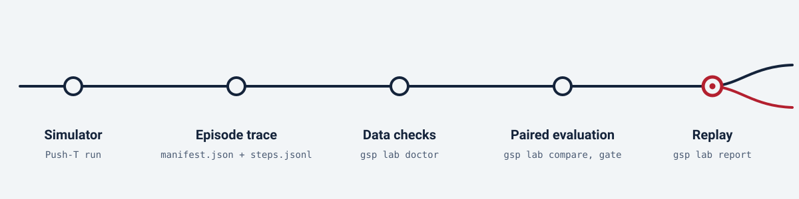

# Architecture

Policy Trace Lab is one subpackage, `guided_streaming_policy/lab/`. Every capability reads or writes the same versioned **episode trace**, so data checks, comparisons and replay always agree on what an episode is.

The simulator and the native demonstration data stay untouched. Adapters convert them into traces. Doctor validates traces from either source. The evaluation chain is pair matcher, then checks, then gate. Replay reads the traces and the gate's regression list.

## Artifacts

| Artifact | Written by | Read by |
| --- | --- | --- |
| `manifest.json` and `steps.jsonl` per episode | demonstration reader, exporter | Doctor, pair matcher, gate, report |
| `run_manifest.json` and `resolved_config.json` per run | `gsp lab run` | pair matcher |
| `lab/comparisons/*.json` | you, before the candidate runs | `gsp lab run`, `gsp lab compare` |
| `lab/gates/*.json` | you, before results are inspected | `gsp lab gate` |
| `doctor.json` | `gsp lab doctor` | you, CI |
| `compare.json` | `gsp lab compare` | gate, report |
| `gate.json` and the exit code | `gsp lab gate` | CI, report |
| `report.html` | `gsp lab report` | you, reviewers |
| `guided_streaming_policy/lab/tasks/pusht/pins.json` | maintainers (deliberate edit) | `gsp lab policies`, `gsp lab run`, tests |

## Modules

| Module | Responsibility |
| --- | --- |
| `schema/` | The trace contract: constants, JSON Schemas (generated into `schemas/`), config loaders, canonical JSON, hashing, trace IO. One source of truth. |
| `adapters.py` | Shared helpers: config resolution, pin loading, policy table, trace reading, write-once file output. |
| `doctor.py` | The nine Dataset Doctor checks and the `doctor.json` report. |
| `exporter.py` | Runs one variant of a comparison through the task's run hook and writes traces. |
| `pairing.py` | Matches baseline and candidate episodes by (task, condition, seed) and writes `compare.json`. |
| `checks.py` | Native success (copied), failure categories, separation proxy, measurement coverage. |
| `gate.py` | Applies the checked-in gate config to `compare.json` and decides the exit code. |
| `report.py`, `assets/` | Self-contained `report.html` with the replay view. |
| `cli.py` | Argument parsing and wiring for `gsp lab`. |
| `cli_tasks.py` | The `gsp lab tasks` command group (list, new, check) and the scaffold writer. |
| `testing.py` | The conformance kit (`run_conformance`, `TaskContractTests`): standard library only, used by `tasks check` and by every pack's own test. |
| `scaffold/` | Text templates (package data, not Python modules) for the pack that `tasks new` writes: a working one-dimensional rail simulator. |
| `tasks/base.py` | The task-adapter contract (a `Protocol` and frozen dataclasses). |
| `tasks/registry.py` | Discovers task packs through the `gsp_lab.tasks` entry-point group and loads one at a time. It keeps no list of tasks. |
| `tasks/pusht/` | The Push-T adapter: policies, pins, demonstration reader, run hook. |

## Dependency rules

Dependencies point one way. `tests/lab/test_architecture.py` parses the imports of every module with `ast` and fails on any other edge.

| Module | May import |
| --- | --- |
| `schema` | nothing else in `lab` |
| `adapters` | `schema`, `tasks.base` |
| `exporter` | `schema`, `adapters`, `tasks.base` |
| `doctor`, `pairing`, `checks` | `schema`, `tasks.base` |
| `gate` | `schema`, `pairing`, `checks`, `tasks.base` |
| `report` | `schema` |
| `registry` (`tasks/registry.py`) | `tasks.base`, and `importlib.metadata` from the standard library |
| `testing` | every lab module except `cli` and `cli_tasks` |
| `cli_tasks` | `testing`, `tasks.registry`, `tasks.base` |
| `cli` | everything |
| `tasks/base.py` | `schema` |
| `tasks/<task>` | `schema`, `adapters`, `tasks.base`, its own modules |

More rules, each with a test:

- The core never imports a task package. Only `cli` and `tasks/registry.py` refer to one (the registry by dotted-path string, from package metadata).
- Nothing in the core imports `testing`; only `cli_tasks` does.
- Entry points are read only in `tasks/registry.py`, `testing.py` and `cli_tasks.py`, and the registry holds no hard-coded dictionary of tasks. Both are tested, each on a synthetic violation.
- The core contains no task name such as `pusht`. The only exemption is the default `--task pusht` in `cli.py`. The scaffold templates are scanned too.
- Research code (`guided_streaming_policy/core`, `Push-T/`, `Robomimic/`) never imports `lab`. The lab imports research code only inside `tasks/pusht`.
- The default install has no new dependency. Everything outside `tasks/pusht` uses only the standard library; `numpy`, `zarr` and `torch` are imported lazily inside `tasks/pusht`.
- Every module declares `__all__`, has typed public functions, stays under 400 lines, and has no function over 50 lines or complexity over 10.

These amend the build prompt's table in two places: every core module may import `tasks.base` (the contract), and `exporter` and tasks may import `adapters`. The reasons are in [decisions](decisions.md).

## Quality gates and their scope

`ruff`, `mypy` (strict) and `vulture` run on `guided_streaming_policy/lab` and `tests/lab` only. They are strict there and CI fails on any finding. Research code (`guided_streaming_policy/core`, `Push-T/`, `Robomimic/`, the legacy CLI modules) and the legacy tests in `tests/` are checked only by `python -m compileall` and their own unit tests. Running `ruff` on the whole repository reports roughly 2,250 findings, nearly all in that legacy code; they are not part of this change and are not gated. A new lab module, or code moved into the lab, falls under the strict gates the moment it lands in those two directories.

## How a run is recorded

The Push-T runners are monolithic functions that run three episodes per call using a module-global `env`. The exporter swaps that global for a recording proxy, calls the unchanged runner, and keeps the third episode (the guided one). With the exporter off, the default Push-T run path is not touched. See [baseline](baseline.md) for the details and the source references.

## Adding a simulator

A simulator is one task pack: a package that registers itself under the `gsp_lab.tasks` entry point, with no edit to the core. A built-in pack (Push-T) is a folder under `lab/tasks/` plus one line in `pyproject.toml`. See [adding a simulator](adding-a-task.md). A contract test (`tests/lab/test_toy_task_contract.py`) scaffolds a pack into a temporary directory, imports it and runs the whole offline pipeline on it, so any Push-T assumption in the core fails the test.
